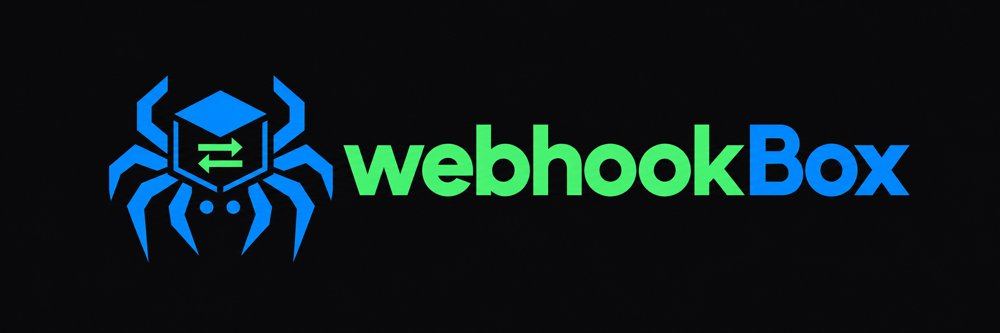
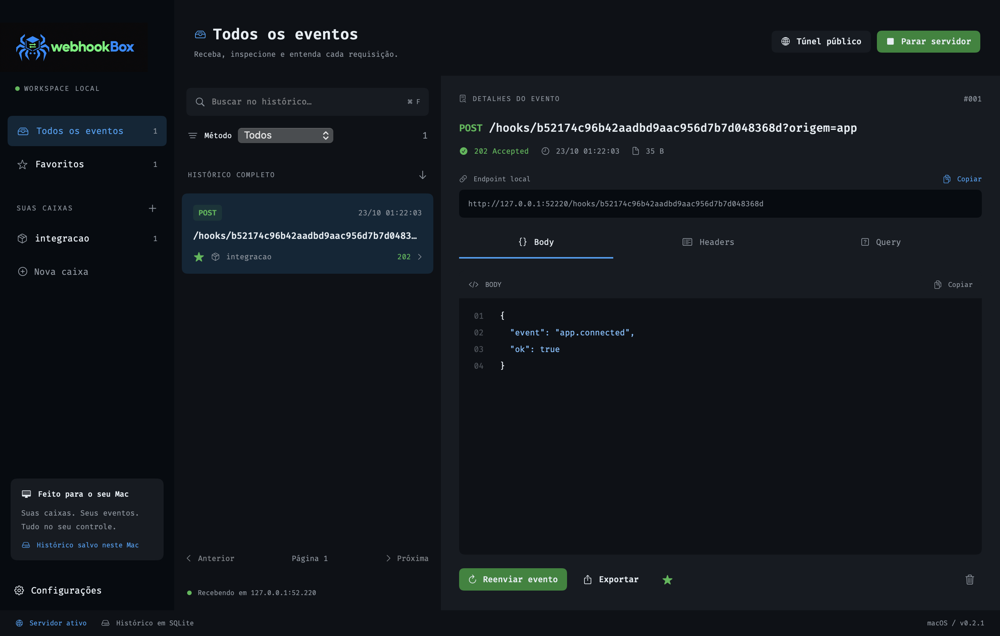

<p align="center">
  
</p>

# WebhookBox para macOS

Receba, inspecione e reenvie webhooks em um aplicativo nativo para Mac. Organize eventos em caixas, consulte headers e body e mantenha o histórico no seu computador. Interface em SwiftUI, fonte Fira Code e tema escuro alinhado à suite Endpoint Mapper.

## Novo visual — 0.2.1

- Divisórias claras e contornos removidos; áreas separadas pelos tons de fundo.
- Fundos e textos alinhados ao Endpoint Mapper, mantendo a identidade azul/verde do WebhookBox.
- Botões verdes menos intensos e seleção preenchida.
- Organização das áreas, fonte Fira Code e recursos da 0.2.0 preservados.



Esta atualização é visual e não adiciona uma nova migração de dados. O diagnóstico nativo Intel passou, incluindo captura HTTP, pesquisa, favoritos, inspeção e renderização. Ambos os instaladores tiveram a integridade verificada; execução em Apple Silicon continua pendente.

## Download

**Requer macOS Sequoia 15 ou superior.** Escolha o arquivo correspondente ao processador do seu Mac:

| Seu Mac | Download |
| --- | --- |
| Apple Silicon — M1 ou posterior | [Baixar WebhookBox para Apple Silicon (.dmg)](https://github.com/Mercuttius/webhookBox-macOS/releases/download/v0.2.1/WebhookBox-macOS-arm64.dmg) |
| Intel | [Baixar WebhookBox para Intel (.dmg)](https://github.com/Mercuttius/webhookBox-macOS/releases/download/v0.2.1/WebhookBox-macOS-x86_64.dmg) |

Para identificar o processador, abra **menu Apple  → Sobre Este Mac**. Se aparecer “Chip Apple”, escolha Apple Silicon. Se aparecer “Processador Intel”, escolha Intel.

[Ver a versão e todos os arquivos](https://github.com/Mercuttius/webhookBox-macOS/releases/tag/v0.2.1) · [Verificar integridade dos downloads](https://github.com/Mercuttius/webhookBox-macOS/releases/download/v0.2.1/SHA256SUMS.txt)

> **Versão de testes (v0.2.1).** Os aplicativos possuem assinatura local (*ad hoc*), mas ainda não têm assinatura Developer ID nem notarização da Apple. A versão Intel foi executada e testada localmente; a versão Apple Silicon foi compilada e teve sua arquitetura e integridade verificadas, mas ainda não foi executada em um Mac Apple Silicon. A instalação após download em outro Mac ainda precisa de validação.

## Instalação

1. Baixe o `.dmg` correspondente ao seu Mac.
2. Abra o arquivo baixado.
3. Arraste **WebhookBox** para a pasta **Applications / Aplicativos** mostrada na janela.
4. Ejete a imagem de disco.
5. Abra **Aplicativos → WebhookBox**.

**Não é necessário instalar Node.js, npm, Homebrew ou cloudflared.** Os componentes necessários já acompanham cada aplicativo na arquitetura correta.

### Se o macOS bloquear a primeira abertura

Como esta versão ainda não tem Developer ID/notarização, o macOS pode avisar que não consegue verificar o desenvolvedor ou a segurança do app.

Se você baixou o arquivo deste repositório e deseja autorizá-lo:

1. Tente abrir o WebhookBox em **Aplicativos** uma vez.
2. Abra **Ajustes do Sistema → Privacidade e Segurança**.
3. Localize o aviso referente ao **WebhookBox** e clique em **Abrir Mesmo Assim**.
4. Confirme a abertura e autentique-se, se solicitado.

Normalmente essa autorização é necessária apenas na primeira abertura dessa versão. Macs gerenciados por empresas podem impedir a autorização. Não é necessário desativar globalmente as proteções do macOS.

Veja as [instruções oficiais da Apple](https://support.apple.com/pt-br/102445). Se aparecer um aviso diferente, como arquivo danificado, baixe novamente o DMG e [relate o problema](https://github.com/Mercuttius/webhookBox-macOS/issues), informando a versão do macOS e o processador.

## Primeiro webhook local

1. Abra o WebhookBox.
2. Clique em **Nova caixa**, digite um nome, como `pagamentos`, e confirme.
3. Selecione a caixa na barra lateral.
4. Clique em **Iniciar servidor**. A porta padrão é `3000`.
5. Clique em **Copiar URL** na caixa selecionada.
6. Envie uma requisição HTTP para essa URL usando sua aplicação, Postman, Insomnia ou o Terminal.

Exemplo no Terminal: substitua `COLE_A_URL_DA_CAIXA_AQUI` pela URL copiada do app.

```sh
curl -X POST 'COLE_A_URL_DA_CAIXA_AQUI' \
  -H 'Content-Type: application/json' \
  -d '{"event":"payment.approved","amount":4990,"currency":"BRL"}'
```

O servidor retorna `202` quando o evento é salvo. A lista é atualizada aproximadamente a cada segundo. Selecione o evento para consultar **Body**, **Headers** e **Query**.

Se a porta estiver ocupada, encerre o outro servidor ou escolha outra porta em **Configurações** antes de iniciar. Copie novamente a URL depois de alterar a porta.

## Receber webhooks da internet

1. Crie uma caixa e inicie o servidor local.
2. Clique em **Túnel público → Abrir túnel público**.
3. Aguarde o estado **Túnel público conectado**.
4. Copie a **URL pública** da caixa desejada.
5. Configure essa URL no serviço que enviará os webhooks.

O app usa Cloudflare Quick Tunnels, sem exigir uma conta Cloudflare. A URL HTTPS é temporária e muda a cada nova conexão. Quem tiver a URL pode enviar eventos; o tráfego passa pela Cloudflare. O Mac precisa permanecer ligado, conectado e com o app aberto. O serviço é destinado a testes e não oferece garantia de disponibilidade. [Documentação da Cloudflare](https://developers.cloudflare.com/tunnel/get-started/quick-tunnels/).

Para interromper o acesso, use **Encerrar túnel**, pare o servidor ou encerre o aplicativo com **⌘Q**. Fechar apenas a janela não equivale a encerrar o app.

## Inspecionar, exportar e reenviar

- **Buscar e filtrar:** pesquise em todo o histórico por palavras/frases em path, query, headers e body textual, combinando caixa e método HTTP. O último termo aceita prefixo; não é busca por substring arbitrária ou conteúdo binário.
- **Paginação:** use Anterior e Próxima para navegar em páginas de 100 eventos.
- **Favoritos:** clique na estrela do evento e consulte a seção Favoritos na barra lateral.
- **Copiar:** copie URLs e conteúdo das abas.
- **Exportar:** salve o evento completo em JSON; o body original fica em base64 para preservar os bytes, inclusive conteúdos binários.
- **Reenviar evento:** informe a URL de destino e confirme em **Enviar agora**. Authorization e cookies são removidos por padrão; a opção pode ser desativada. Reenvios podem repetir ações reais no serviço de destino.
- **Excluir evento ou caixa:** remova itens do histórico. Excluir uma caixa também remove os seus eventos.

## Histórico e limites

Os dados são armazenados localmente em:

```text
~/Library/Application Support/WebhookBoxDesktop/webhookbox.db
```

O histórico permanece após encerrar ou atualizar o app. O servidor não é iniciado automaticamente ao reabrir. Os dados são separados dos dados do WebhookBox de terminal.

| Item | Limite atual |
| --- | --- |
| Navegação | Todo o histórico, em páginas de 100; contadores globais e por caixa |
| Eventos armazenados | Padrão de 10.000; configurável de 100 a 1.000.000 |
| Tamanho do body | Até 1 MiB por requisição |
| Requisições | Até 120 por minuto |
| Retenção | Padrão de 7 dias; configurável de 0 a 3650 dias. 0 desativa a expiração por idade |

**Configurações → Salvar limites** permite ajustar a retenção e a quantidade de eventos. Reduzir os limites pode excluir eventos antigos. Favoritos também expiram. A quantidade é aplicada nas novas capturas; a limpeza ocorre ao iniciar o servidor e a cada minuto enquanto ele estiver ativo. O índice de pesquisa ocupa espaço local.

Bodies e headers podem conter informações sensíveis e são salvos sem criptografia própria do aplicativo. Para fazer um backup simples, encerre o app antes de copiar a pasta de dados inteira.

## Atualizar da versão 0.1.0

1. Encerre o WebhookBox com **⌘Q**.
2. Instale o novo DMG substituindo o aplicativo em **Aplicativos**.
3. Abra o app. O histórico existente será migrado automaticamente.

Antes de migrar um histórico antigo não vazio, o app cria um backup consistente `backup-before-v2-<id>.db` na pasta de dados. Esse backup não é apagado pela retenção e pode ser removido manualmente depois de verificar a atualização. Não abra o banco migrado com versões antigas do aplicativo.

## Novidades da 0.2.0

- Pesquisa indexada no histórico completo, além dos últimos 100 eventos.
- Paginação, favoritos persistentes e contadores globais/por caixa.
- Retenção e limite de eventos configuráveis.
- Backup automático antes da migração do histórico antigo.
- A página só é recarregada quando o histórico muda.
- Interface nativa preservada, com Fira Code, paleta e ícones existentes.

As novas funções usam apenas armazenamento e processamento locais, sem conta ou serviço pago obrigatório. O túnel público continua sendo opcional e depende da Cloudflare. Filas de entregas, mocks avançados e workflows ainda não fazem parte desta versão.

## Estado desta versão

- Intel: oito testes automatizados passaram, cobrindo captura, exportação, replay, persistência, migração, backup, busca, favoritos, retenção e ciclo de vida simulado do túnel. O diagnóstico nativo validou captura HTTP, pesquisa, favorito, inspeção e renderização. O túnel HTTPS real foi validado na versão anterior.
- Apple Silicon: compilação ARM64, dependências ARM64, assinatura ad hoc e integridade do DMG verificadas. Teste de execução em hardware Apple Silicon pendente.
- Developer ID e notarização: ainda não disponíveis.
- Este repositório disponibiliza os instaladores; o motor original está em [Mercuttius/webhookBox](https://github.com/Mercuttius/webhookBox).

## Créditos e suporte

O app inclui Node.js, cloudflared e Fira Code, com suas licenças no pacote. O motor do WebhookBox utiliza licença MIT.

Encontrou um problema? [Abra uma issue](https://github.com/Mercuttius/webhookBox-macOS/issues) com a arquitetura (Intel/Apple Silicon), versão do macOS e passos para reproduzir. Remova tokens, credenciais e dados pessoais antes de anexar eventos ou capturas.
